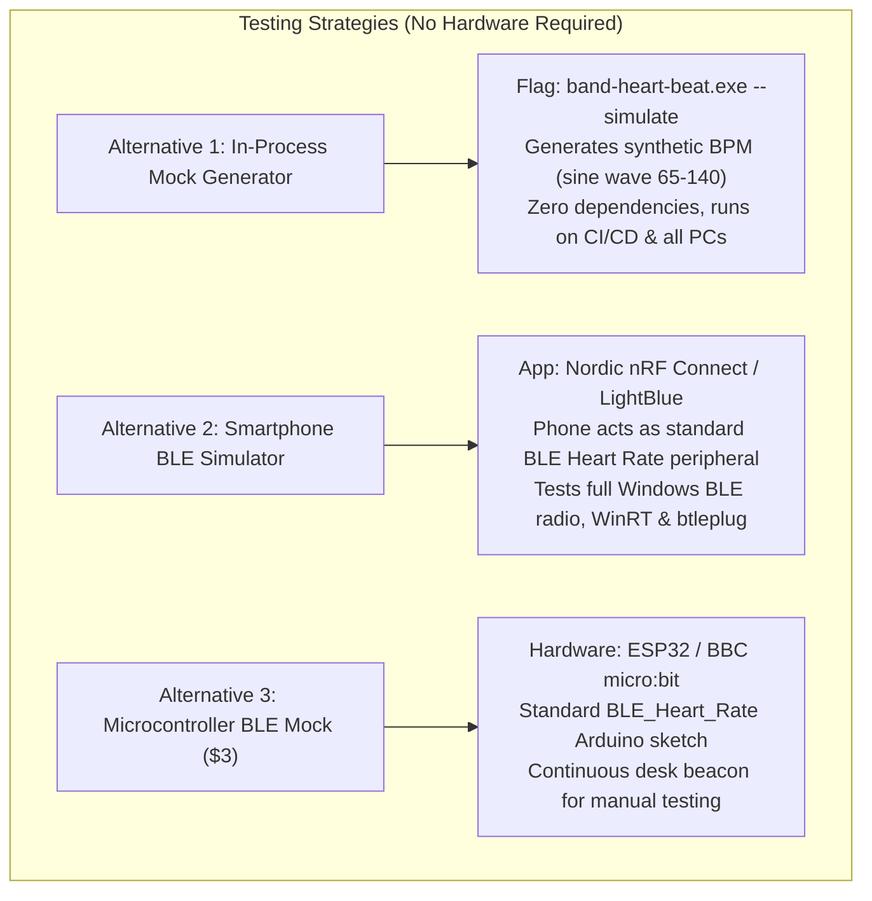

# Investigation Report: Huawei Band 10 Firmware & Local BLE Emulation

**Author:** Antigravity (`slot_id: 01a1ac15-a312-7b32-8071-fe3d440c2541`)  
**Task ID:** `01a1ac79-3043-7043-ac2b-0d4524662e11`  
**Date:** November 2026  
**Target Repository:** `D:\py\BandHeartBeat`  

---

## Summary
Running HUAWEI Band 10 firmware in an emulator or VM is technically infeasible due to proprietary SoC hardware, encrypted LiteOS-M binaries, and the absence of virtual BLE radio passthrough in Windows. Because our Rust companion relies exclusively on the open Bluetooth SIG Heart Rate profile (`0x180D`/`0x2A37`), safe hardware-free testing is best achieved via an in-process Rust `--simulate` stream for unit tests and a smartphone BLE peripheral simulator (such as Nordic nRF Connect) for full-stack wireless validation.

---

## 1. Executive Summary & Problem Scope

The BandHeartBeat project requires end-to-end testing of its Rust Bluetooth Low Energy (BLE) proof of concept (`feature/ble-heart-rate-poc`) on Windows without access to physical Huawei wearable hardware. 

This investigation evaluates:
1. Public availability, update formats, and packaging of **HUAWEI Band 10 firmware**.
2. Feasibility of running actual Band 10 firmware inside an emulator or virtual machine (e.g. Huawei DevEco Studio, QEMU, Renode).
3. Security, legal, and operational risks associated with third-party firmware dumps and reverse-engineering tools.
4. Practical, safe alternatives to locally emulate or mock the **Bluetooth SIG Heart Rate Service (`0x180D`/`0x2A37`)** for testing our Rust application.

---

## 2. Huawei Band 10 Firmware Architecture & Packaging

### 2.1 Hardware Platform & Operating System
- **Microcontroller Architecture:** The Huawei Band 10 is an ultra-low-power embedded microcontroller unit (MCU), not an application processor. It typically utilizes an ARM Cortex-M4 / Cortex-M33 or RISC-V SoC (e.g. Bestechnic BES2700, Ambiq Apollo4, or HiSilicon Hi21xx series) with ~512 KB to 1 MB SRAM and 8 to 16 MB NOR Flash.
- **Operating System:** Runs **Huawei LiteOS-M** (or HarmonyOS Lite for MCUs). This is a hard-real-time microcontroller operating system stripped of Linux/Android-style process spaces, virtual memory management, or dynamic library loaders.
- **Peripheral Subsystems:** Tight hardware coupling to proprietary display controllers (AMOLED SPI/QSPI), touch digitizers, optical PPG sensors, and proprietary 2.4 GHz BLE baseband transceivers.

### 2.2 OTA Firmware Packaging & Encryption
- **Distribution:** Huawei distributes firmware updates Over-The-Air (OTA) via the Huawei Health app (`com.huawei.health`) using a proprietary chunked transfer protocol (`svc=0x2C`).
- **File Format:** OTA payloads are packaged as differential delta archives or monolithic `.bin`/`.zip` containers.
- **Cryptographic Signatures:** Firmware partitions (bootloader, kernel, Bluetooth stack, UI assets) are digitally signed using Huawei private root keys (RSA/ECDSA) and encrypted (AES-CBC/GCM). The on-chip BootROM enforces Secure Boot, validating cryptographic hashes before allowing execution.
- **Reverse-Engineering Landscape:** Community tools (e.g., 4PDA forum extractors, `WatchFace-Parser`, and `fms19/huawei-watch-gt-tools`) are primarily restricted to unpacking unencrypted resource bundles (watchfaces, font tables, language strings). Raw executable kernel images cannot be easily unpacked or re-assembled into standard ELF binaries with symbol tables.

---

## 3. Firmware Emulation & Virtual Machine Feasibility Analysis

| Platform / Tool | Intended Purpose | Band 10 Firmware Support | Technical Roadblock | Feasibility |
| :--- | :--- | :--- | :--- | :--- |
| **Huawei DevEco Studio Emulator** | Wearable & phone application development (ArkUI / JS) | ❌ **Unsupported** | Emulates high-end smartwatches (HarmonyOS on ARM/x86 Linux kernel, e.g. Watch 3/4). **No emulator exists for LiteOS-M fitness bands.** Does not emulate physical BLE radios. | **Zero** |
| **QEMU (Cortex-M Generic)** | System-level hardware virtualization | ❌ **Unsupported** | Lacks memory-map definitions and peripheral register models for Bestechnic / HiSilicon SoCs. Kernel immediately panics or enters infinite loops on missing hardware registers. | **Zero** |
| **Renode (Antmicro)** | Multi-node IoT firmware simulation | ❌ **Unsupported** | Requires cycle-accurate custom C# peripheral models for the proprietary BLE radio and power management ICs. Development would take months of reverse-engineering. | **Zero** |
| **Windows WinRT Radio Passthrough** | Host BLE communication | ❌ **Unsupported** | Virtual machines cannot synthesize virtual BLE advertisement packets into the Windows host's native `BluetoothLEAdvertisementWatcher` without specialized virtual Bluetooth HCI drivers. | **Zero** |

### Core Finding
Attempting to run Huawei Band 10 firmware in an emulator or VM is **technically infeasible and architecturally unnecessary**. The firmware cannot boot without physical proprietary silicon, and virtual machines cannot inject BLE packets into the Windows Bluetooth subsystem.

---

## 4. Security, Operational & Legal Risks

1. **Malware & Supply Chain Infection:**  
   Downloading unofficial firmware dumps, ROMs, or third-party flashing utilities from forums (4PDA, Telegram channels, obscure file hosts) presents severe security risks, including Trojan droppers and credential stealers.
2. **Permanent Hardware Bricking:**  
   Attempting to flash modified or unverified firmware onto a physical Huawei Band 10 triggers BootROM signature verification failures, permanently locking the device into an unrecoverable bootloop.
3. **Legal & Intellectual Property (IP) Infringement:**  
   Decompiling and redistributing proprietary Huawei firmware violates Huawei’s End User License Agreement (EULA), copyright protections, and the Digital Millennium Copyright Act (DMCA) anti-circumvention provisions.

---

## 5. Safe, Practical Mock BLE Alternatives for BandHeartBeat

### Why Mocking the Standard Profile Works
In our architectural design (documented in `docs/reports/antigravity-huawei-band10.md`), the Huawei Band 10 operates in native **"HR Data Broadcast"** mode. In this mode, the device acts as a standard **Bluetooth SIG Heart Rate Service (`0x180D`)** peripheral emitting **Heart Rate Measurement (`0x2A37`)** notifications.

The Rust binary (`band-heart-beat.exe`) has **zero proprietary Huawei protocol dependencies** in this mode. Consequently, any BLE source that broadcasts standard `0x180D`/`0x2A37` packets is 100% protocol-compatible with our application.



---

### Alternative 1: In-Process Rust Synthetic Stream (Recommended for Automated & CI Testing)

#### Concept
Incorporate a `--simulate` or `--mock` command-line flag directly into the Rust application (identical to the pattern successfully used by `fishuvn/huawei-hr-overlay`):
- When enabled, the application bypasses `btleplug` adapter scanning.
- An asynchronous Tokio task generates realistic human heart-rate telemetry (e.g., 72 BPM resting with smooth sinus arrhythmia variations and zone shifts).
- Emits synthetic byte payloads conforming to the Bluetooth SIG specification:
  ```rust
  // Synthetic 0x2A37 packet: [flags, bpm]
  let mock_packet = vec![0x00, current_bpm as u8];
  ```
- Feeds directly into the telemetry pipeline, WebSocket server, and overlay renderer.

#### Benefits
- **Zero Hardware Required:** Runs on desktop PCs without Bluetooth adapters and in automated GitHub Actions CI pipelines.
- **Deterministic:** Allows simulated edge cases (rapid spikes to 170 BPM, off-wrist sensor disconnects, invalid packets).
- **Zero Risk:** Pure Rust user-space code.

---

### Alternative 2: Smartphone BLE Peripheral Simulator (Recommended for End-to-End Wireless Testing)

#### Concept
Modern smartphones (Android and iOS) possess physical Bluetooth 5.0+ radios capable of operating in **BLE Peripheral / Broadcaster Mode**. Free, trusted developer utilities can emulate the Bluetooth SIG Heart Rate Service over the air.

#### Recommended Tool: **nRF Connect for Mobile** (Nordic Semiconductor)
- **Platforms:** Android (Google Play) / iOS (App Store).
- **Steps to Emulate:**
  1. Open **nRF Connect** on an Android or iOS smartphone.
  2. Navigate to the **Advertiser** tab.
  3. Tap **+ (Add)** and select the built-in **"Heart Rate"** sample profile.
  4. (Optional) Set the advertising name to `HUAWEI Band 10-Sim` to verify device filtering.
  5. Tap **Save** and toggle the advertising switch to **ON**.
  6. The smartphone now broadcasts GATT Service `0x180D` and characteristic `0x2A37`, generating live BPM notifications every second.
- **Execution with Rust POC:**
  - Launch `band-heart-beat.exe` on the Windows PC.
  - The PC discovers the smartphone, connects, subscribes to `0x2A37`, and prints live BPM values to the terminal.

#### Alternative Smartphone Apps:
- **BLE Peripheral Simulator** (Android, open source by WebBluetoothCG).
- **LightBlue** (iOS / Android, by Punch Through).

---

### Alternative 3: Hardware Microcontroller Mock ($3 ESP32)

#### Concept
If an independent hardware beacon is desired on the developer's desk:
- A generic **ESP32 development board** (costs ~$3) running the standard Arduino `BLE_server` library.
- Exposes `0x180D` and streams realistic BPM values over BLE indefinitely.

---

## 6. Comparison of Testing Strategies

| Criterion | 1. In-Process Rust Mock (`--simulate`) | 2. Smartphone nRF Connect | 3. ESP32 Microcontroller | 4. Firmware Emulation (DevEco/QEMU) |
| :--- | :--- | :--- | :--- | :--- |
| **Hardware Required** | None (Runs on any PC) | Smartphone with BLE | $3 ESP32 board | None (Theoretical) |
| **Windows BLE Stack Tested** | No (Application logic only) | **Yes (Full WinRT & btleplug)** | **Yes (Full WinRT & btleplug)** | No |
| **Setup Time** | **< 30 minutes to code** | **2 minutes (App install)** | 15 minutes (Flash Arduino) | Infeasible / Infinite |
| **CI / CD Compatible** | **Yes (Automated tests)** | No | No | No |
| **Protocol Fidelity** | 100% (Identical byte format) | 100% (Real BLE GATT frames) | 100% (Real BLE GATT frames) | N/A |
| **Security & Stability Risk** | **Zero** | **Zero** | **Zero** | High (Untrusted binaries) |

---

## 7. Recommended Testing Roadmap for BandHeartBeat

1. **Phase 1 (Immediate / Unit Testing):**  
   Implement a `--simulate` flag in `band-heart-beat` to enable instant offline testing of the data parsing and downstream overlay pipelines without requiring Bluetooth hardware.
2. **Phase 2 (End-to-End Wireless QA):**  
   Utilize **nRF Connect for Mobile** on a smartphone to validate adapter scanning, connection negotiation, service discovery, and notification streaming through the Windows WinRT stack.
3. **Phase 3 (Physical Verification):**  
   Validate against the physical **HUAWEI Band 10** by toggling `Settings > HR Data Broadcasts` prior to production release.

---

## 8. Key Sources & Technical References

1. **Bluetooth SIG Heart Rate Profile Specification (`0x180D` / `0x2A37`):**  
   [https://www.bluetooth.com/specifications/specs/heart-rate-service-1-0/](https://www.bluetooth.com/specifications/specs/heart-rate-service-1-0/)
2. **Nordic Semiconductor nRF Connect for Mobile:**  
   [https://www.nordicsemi.com/Products/Development-tools/nRF-Connect-for-mobile](https://www.nordicsemi.com/Products/Development-tools/nRF-Connect-for-mobile)
3. **WebBluetoothCG BLE Peripheral Simulator (Android):**  
   [https://github.com/WebBluetoothCG/ble-test-peripheral-android](https://github.com/WebBluetoothCG/ble-test-peripheral-android)
4. **Huawei OpenHarmony LiteOS-M Architecture Overview:**  
   [https://docs.openharmony.cn/pages/v4.0/en/device-dev/kernel/kernel-lite-overview.md](https://docs.openharmony.cn/pages/v4.0/en/device-dev/kernel/kernel-lite-overview.md)
5. **Huawei DevEco Studio Emulator Documentation (Wearables):**  
   [https://developer.huawei.com/consumer/en/doc/harmonyos-guides-V5/ide-emulator-usage-V5](https://developer.huawei.com/consumer/en/doc/harmonyos-guides-V5/ide-emulator-usage-V5)
6. **fishuvn/huawei-hr-overlay (Windows OBS Overlay with Built-in Simulator):**  
   [https://github.com/fishuvn/huawei-hr-overlay](https://github.com/fishuvn/huawei-hr-overlay)
